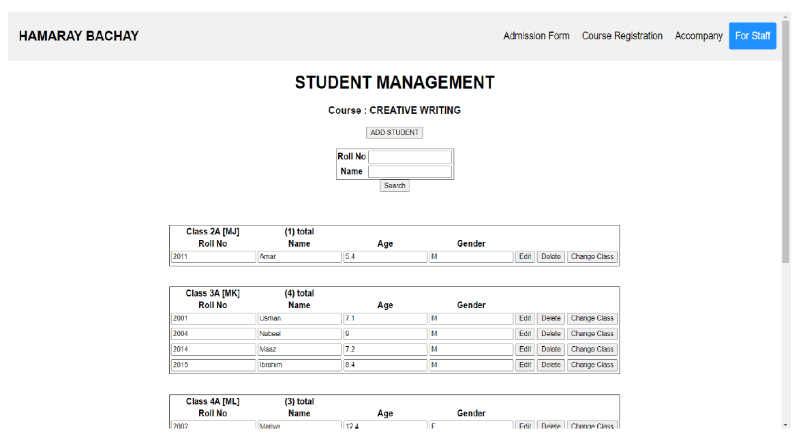
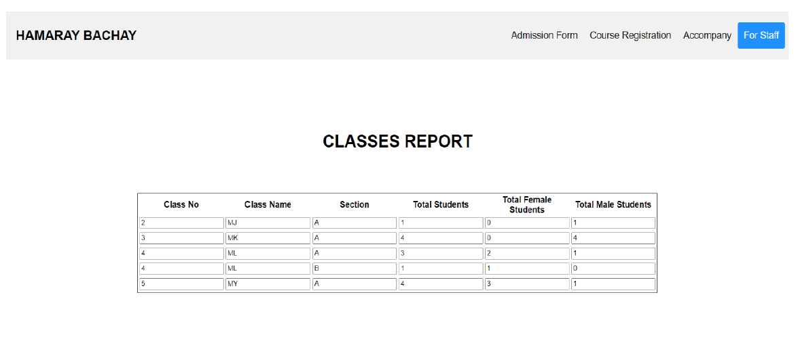
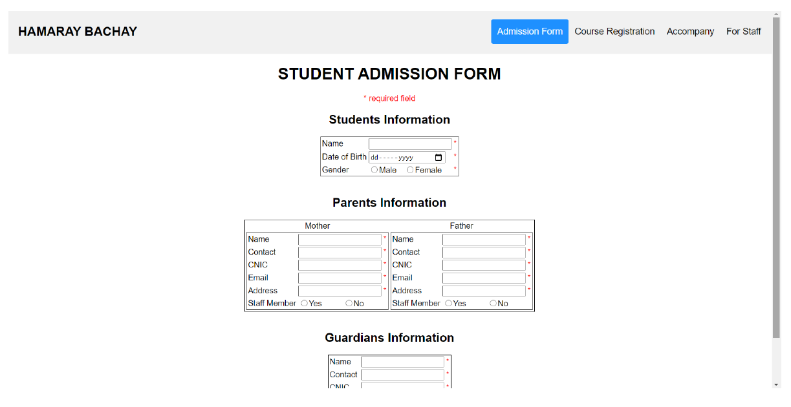
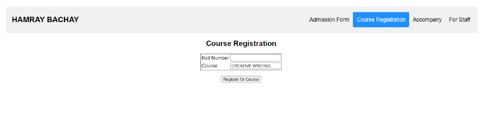
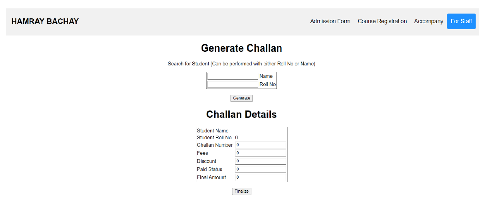
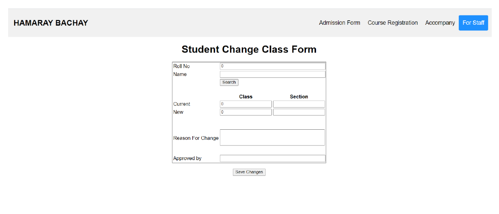

# Hamaray Bachay — Student Registration Database

A school administration website backed by an Oracle relational database. The project combines a PHP interface with a substantial SQL schema to manage admissions, guardians, classes, courses, registrations, reports, and fee challans.


## Highlights

- Register students and their parent or guardian records.
- Assign students to classes and courses.
- Change a student's class while retaining database history.
- Generate and finalize fee challans.
- Record authorized people accompanying students.
- Search student and parent records.
- Produce class and student reports.
- Uses Oracle sequences, triggers, views, and stored queries.

## Architecture

```text
src/
├── db scripts/
│   ├── DDL and DML.sql          Schema, triggers, sequences, and seed data
│   └── All Stored Queries.SQL   Reports, views, and project queries
├── frontend web/                PHP pages and shared Oracle connection
├── Dataset.xlsx                 Original project dataset
├── Project ER.png               Entity-relationship diagram
└── Table Description.xlsx       Schema reference
```

The database design is the project's main technical focus. See [Database design](docs/DATABASE.md) for a concise guide to its tables and behavior.

## Run locally

### Prerequisites

- Oracle Database (Oracle XE is sufficient)
- PHP with the OCI8 extension
- A local web server such as Apache through XAMPP

### Setup

1. Create an Oracle user/schema for the application.
2. Run `src/db scripts/DDL and DML.sql` in that schema.
3. Configure the database connection as environment variables. `.env.example` shows the expected values:

   ```bash
   export ORACLE_DB_USER="school_app"
   export ORACLE_DB_PASSWORD="your-password"
   export ORACLE_DB_DSN="localhost/XE"
   ```

   For Apache/XAMPP, provide the same variables in the web server environment rather than committing them to the repository.

4. Serve `src/frontend web` through your PHP-capable web server.
5. Open `insertion.php` to start with the student admission workflow.

Database configuration is centralized in `src/frontend web/database.php`. Real credentials should never be added to source control.

## Screenshots

| Student management | Class report |
| --- | --- |
|  |  |

| Student admission | Course registration |
| --- | --- |
|  |  |

| Fee challan | Change class |
| --- | --- |
|  |  |

More interface captures are available in the [`extras`](extras) directory.

## Project status

This repository preserves the original Oracle schema and PHP workflows with improved configuration and documentation. Production deployment requires authentication, authorization, input validation, CSRF protection, and a broader security review.

## Contributors

- [Sameet Asadullah](https://github.com/SameetAsadullah)
- [Tayyab Ali](https://github.com/DarkDragz)
- [Nabeel Danish](https://github.com/NabeelDanish)

## License

Licensed under the [MIT License](LICENSE).
